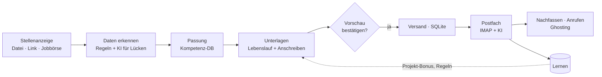

# Bewerbungs-Assistent


Ein lokales Werkzeug, das die Jobsuche organisiert: Es liest Stellenanzeigen,
erstellt passende Unterlagen, behält jede Bewerbung im Blick, erinnert ans
Nachfassen und Anrufen und wertet Antworten aus dem Postfach aus – mit einer
**lokalen KI** (Ollama), die nur dort eingesetzt wird, wo Regeln nicht reichen.

> **Kein Massenversand.** Jede Bewerbung wird als Vorschau gezeigt und erst nach
> Bestätigung verschickt. Lebenslauf-Inhalte kommen ausschließlich aus den eigenen
> Daten – die KI erfindet nichts dazu.

## Warum?

Ich habe das Projekt während meines Quereinstiegs in die Softwareentwicklung für
meine eigene Jobsuche gebaut. Nach ein paar Dutzend Bewerbungen wird es
unübersichtlich: Wo habe ich mich beworben? Wer hat nicht geantwortet? Wann sollte
ich nachfragen? Und welche Bewerbungen haben eigentlich funktioniert?

## Ausprobieren in 1 Minute

```bash
git clone https://github.com/DKuss1994/bewerbungs-assistent.git
cd bewerbungs-assistent
python -m venv venv && source venv/bin/activate
pip install -r requirements.txt
python -m src.demo
```

Die Demo braucht weder KI noch Postfach noch Internet. Sie arbeitet mit erfundenen
Daten in `demo/` und zeigt die ganze Pipeline:

```text
📞 Anruf fällig: Kontor Software GmbH – Backend-Entwickler (m/w/d)
👤 Frau Lea Beispiel
☎️ 040 98765
🗓️ Beworben am 26.10.2026 per Mail, nachgefragt am 11.11.2026 – seit 24 Tagen keine Antwort
🎯 Gefordert: Python, SQL, Docker, Git
📊 Passung: 70 %
🧩 Deine Projekte im Anschreiben: Bewerbungs-Assistent, Bibliotheks-API

💬 Vorschlag: „Guten Tag, mein Name ist Max Mustermann. Ich habe mich am …“
```

## Funktionen

| | |
| :--- | :--- |
| 🔎 **Stellenanzeige lesen** | Firma, Position, E-Mail, Telefon und Ansprechpartner per Regeln erkennen; nur Lücken fragt die KI – und es zählt nur, was wörtlich in der Anzeige steht |
| 🧮 **Passung** | Geforderte Skills mit der eigenen Kompetenz-Datenbank abgleichen; Unbekanntes wird einmal nachgefragt und gemerkt |
| 📄 **Unterlagen** | Lebenslauf (HTML → PDF) deterministisch an die Stelle anpassen, Anschreiben aus Vorlage; die KI formuliert nur den Projekt-Absatz und wird geprüft |
| ✅ **Vorschau & Bestätigung** | Versand per SMTP erst nach `[j]a`; Portal-Bewerbungen landen als fertiger Ordner zum Hochladen |
| 📨 **Postfach** | Antworten per IMAP der richtigen Bewerbung zuordnen, Absage/Einladung und Absagegrund erkennen |
| 📧 **Nachfassen** | Nach 14 Tagen ohne Antwort eine Nachfass-Mail vorschlagen |
| 📞 **Anrufen** | 7 Tage später Erinnerung mit Spickzettel, Ergebnis fließt in die Auswertung |
| 👻 **Ghosting** | Nach 6 Wochen ohne Antwort automatisch abschließen – eine späte Antwort öffnet sie wieder |
| 🧠 **Lernen** | Projekte, die zu Einladungen geführt haben, werden bevorzugt; Absagegründe werden zu Regeln fürs Anschreiben |
| 🔍 **Stellensuche** | Neue Stellen über die Jobbörse der Bundesagentur für Arbeit, bewertet nach Entfernung, Remote-Anteil und Passung |
| 📱 **Telegram-Bot** | Anzeige vom Handy schicken, Daten per Knopf bestätigen, PDFs ansehen, senden; prüft nebenbei das Postfach |

## Pipeline



## Designentscheidungen

- **KI nur wo nötig, immer mit Fallback.** Erkennung und Auswertung laufen zuerst
  über Regeln. Ist Ollama nicht erreichbar, arbeitet alles mit Keywords und festen
  Texten weiter. Getestet auf einer GTX 970 mit 4 GB VRAM.
- **Zwei Modelle.** `qwen2.5:3b` (< 1 s) sortiert Mails ein, `qwen2.5:7b` schreibt
  den Projekt-Absatz. Das kleine Modell hat dort Fakten verdreht – daher die
  Trennung und eine Prüfung jeder KI-Antwort (`_ist_brauchbar()`).
- **Deterministischer Lebenslauf.** Bereiche zwischen `<!-- START_X -->` und
  `<!-- END_X -->` werden aus den eigenen Daten gefüllt, nicht generiert.
- **Ein Dialog-Interface.** Der Ablauf fragt und meldet nur über `Dialog`
  (`zeige`, `frage`, `zeige_dateien`). Terminal, Telegram-Bot und Tests
  (`FakeDialog`) sind austauschbare Implementierungen.
- **Lokal und datensparsam.** Alles Persönliche liegt in `data/` und `.env` –
  beides ist in `.gitignore`. Im Code stehen keine Namen oder Pfade.
- **Testbar ohne Außenwelt.** Die Tests bauen eine Fake-Umgebung in `tmp_path`
  und laufen ohne KI, Netz und echte Datenbank.

## Einrichten für die eigene Jobsuche

```bash
python -m src.einrichtung          # legt data/ mit Vorlagen und .env an
python -m src.einrichtung pruefen  # zeigt, was noch fehlt

# optional: lokale KI
ollama pull qwen2.5:3b-instruct
ollama pull qwen2.5:7b-instruct
```

| Datei in `data/` | Inhalt |
| :--- | :--- |
| `profil.json` | Name, Links, E-Mail-Text, Skills nach Kategorien |
| `projekte.json` | Projekte mit Tags für die automatische Auswahl |
| `profiltexte.json` | Untertitel und Profiltext je Berufsrichtung |
| `anschreiben_vorlage.txt` | Anschreiben mit `{position}`, `{unternehmen}`, `{projekte_abschnitt}` … |
| `lebenslauf/*.html` | Lebenslauf-Vorlage mit Markern |
| `kriterien.json` | optional: PLZ, Umkreis, Remote-Wünsche für die Stellensuche |

## Nutzung

```bash
python preview.py anzeige.txt          # nur Unterlagen erzeugen → data/preview/
python -m src.main anzeige.txt         # bewerben (oder ein Link statt Datei)

python -m src.main offen               # Was ist fällig?
python -m src.main alle                # alle Bewerbungen
python -m src.main postfach            # Antworten einlesen und lernen
python -m src.main nachfassen          # Nachfass-Mails (mit Vorschau)
python -m src.main anrufen             # Anruf-Spickzettel
python -m src.main report              # Statistik und Gelerntes
python -m src.main stellen             # neue Stellen vorschlagen

```

## Telegram-Bot

Bewerben vom Handy: Anzeige als Text, Link, `.txt` oder `.pdf` an den Bot schicken,
Firma, Position und E-Mail per Knopf bestätigen, die PDFs ansehen und mit ✅ senden.

<!-- Screenshots: docs/telegram-*.png -->

**Einrichten**

1. In Telegram [@BotFather](https://t.me/BotFather) schreiben, `/newbot` → den Token
   als `TELEGRAM_TOKEN` in `.env` eintragen.
2. `python -m src.telegram_bot` starten und dem Bot eine Nachricht schicken. Er
   antwortet mit deiner Chat-ID → als `TELEGRAM_CHAT_ID` in `.env` eintragen und neu
   starten.
3. Optional mit dem Rechner starten: `python -m src.telegram_bot --dienst` legt einen
   systemd-Benutzerdienst an.

**Wie er arbeitet**

- **Kein Server nötig:** Der Bot holt Nachrichten per Long Polling selbst ab – keine
  offenen Ports, keine Bot-Bibliothek, nur `requests`.
- **Nur dein Chat:** Nachrichten von anderen Chat-IDs werden ignoriert.
- **Nie ohne Bestätigung:** Versendet wird erst nach deinem ✅; `/abbrechen` beendet
  jeden Ablauf.
- **Nebenbei:** Je nach `POSTFACH_PRUEFEN` (`taeglich` / `woechentlich` / `aus`) prüft
  er das Postfach, meldet Einladungen und Absagen, fragt nach dem Nachfassen, erinnert
  mit Spickzettel ans Anrufen und schickt einmal pro Woche eine Übersicht.

| Befehl | |
| :--- | :--- |
| `/stellen` | Neue Stellen suchen und vorschlagen |
| `/offen` | Was läuft, was ist fällig |
| `/alle` | Alle Bewerbungen auf einen Blick |
| `/postfach` | Postfach prüfen, nachfassen, Anrufe |
| `/report` | Statistik und Gelerntes |
| `/cooldown` | Re-Bewerbungen prüfen |
| `/hilfe` · `/abbrechen` | Hilfe · laufenden Vorgang beenden |

## Tests

```bash
pytest
```

## Tech-Stack

Python 3.14 · SQLite · Ollama (Qwen 2.5) bzw. Mistral-API · WeasyPrint ·
IMAP/SMTP · Telegram Bot API (direkt über `requests`) · Jobbörsen-API der BA · pytest ·
GitHub Actions

## Lizenz

MIT – siehe [LICENSE](LICENSE).
